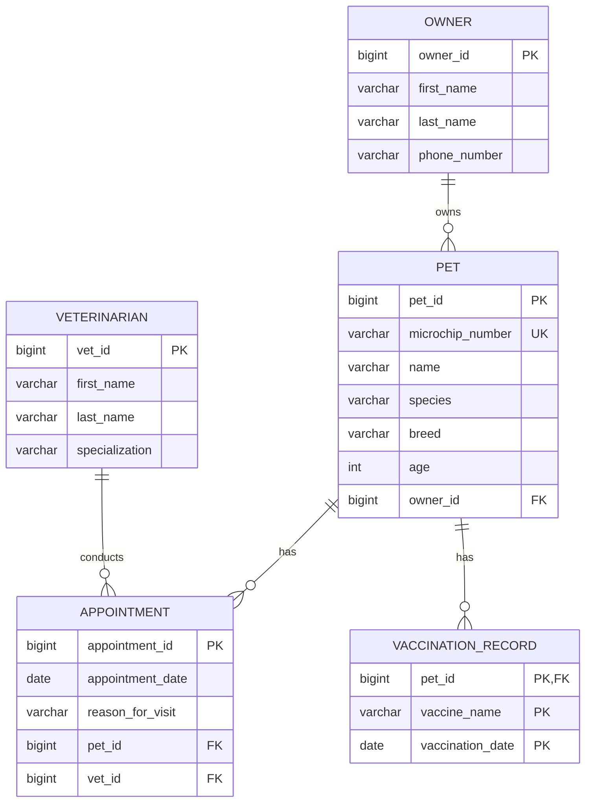

# Pet Veterinary Clinic — Logical ERD for Finals

This combines the INFOMAN1 Week 3/4 veterinary-clinic data model with the WEBDEV2 Week 8 unique microchip requirement. The logical entity `pet_owner` is physically named `owner`, consistent with the Week 4 SQL DDL.

## Cardinality and participation

| Relationship | Parent cardinality | Child cardinality | Meaning |
|---|---:|---:|---|
| Owner–Pet | Owner `0..*` pets | Pet exactly `1` owner | An owner may have no pets or many; each pet belongs to one owner. |
| Pet–Appointment | Pet `0..*` appointments | Appointment exactly `1` pet | A pet may have no appointments or many; each appointment refers to one pet. |
| Veterinarian–Appointment | Veterinarian `0..*` appointments | Appointment exactly `1` veterinarian | A vet may have no appointments or many; each appointment has one vet. |
| Pet–Vaccination Record | Pet `0..*` records | Vaccination record exactly `1` pet | A pet may have no vaccinations or many; each vaccination record belongs to one pet. |

## Primary and foreign keys

- `owner.owner_id`, `pet.pet_id`, `veterinarian.vet_id`, and `appointment.appointment_id` are primary keys.
- `pet.owner_id` references `owner.owner_id`.
- `appointment.pet_id` references `pet.pet_id`.
- `appointment.vet_id` references `veterinarian.vet_id`.
- `vaccination_record` has a composite primary key `(pet_id, vaccine_name, vaccination_date)` and `pet_id` is also a foreign key.
- `pet.microchip_number` is globally unique as required by the WEBDEV2 Pet JPA lab.

No additional many-to-many junction table is invented. `appointment` is an event record that references one pet and one veterinarian and has its own date and reason attributes.
