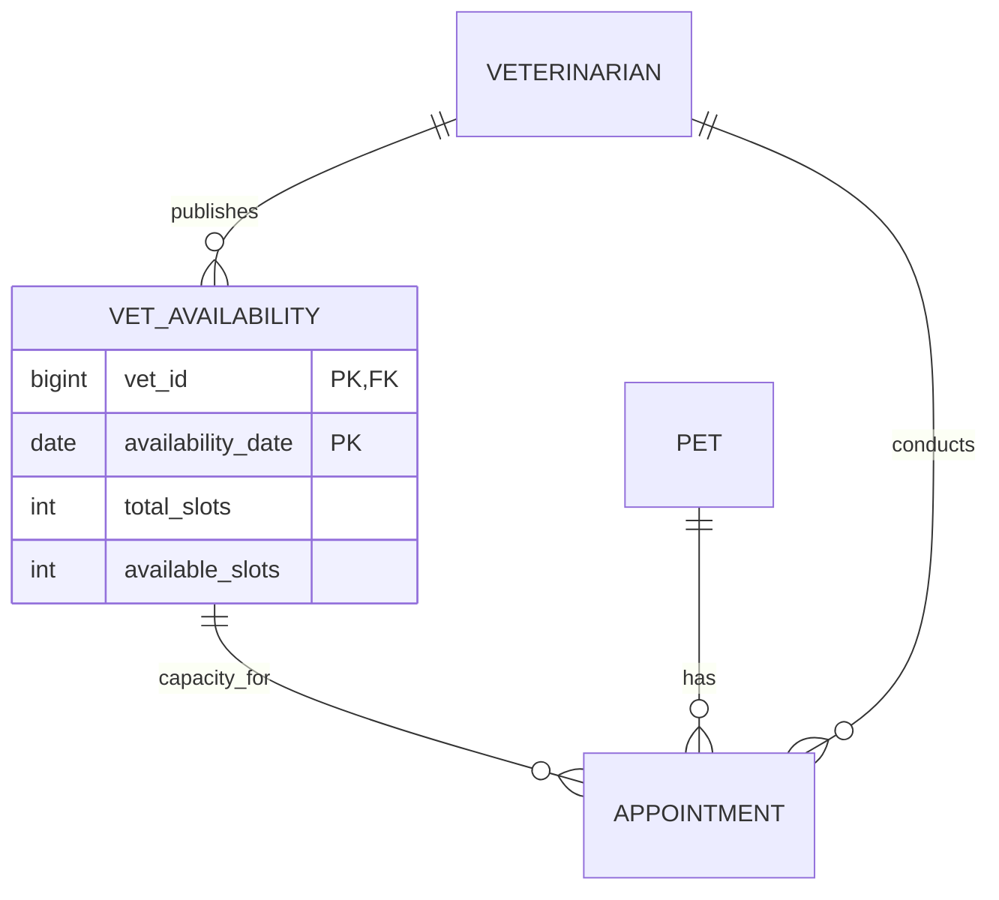

# Week 14 ERD Update — Veterinarian Availability

Week 13's five core tables remain unchanged. Week 14 adds one domain table to represent the number of appointment slots each veterinarian can accept on a date.

`vet_availability` has composite primary key `(vet_id, availability_date)`. Its veterinarian foreign key points to `veterinarian.vet_id`. Checks ensure `total_slots >= 0` and `0 <= available_slots <= total_slots`. An appointment booking decreases `available_slots` and inserts one appointment in a single transaction. Cancellation deletes the appointment and restores one slot in the same transaction. The invariant is: **for each veterinarian and date, available capacity never becomes negative or exceeds total capacity, and every successful booking consumes exactly one slot.**
